# Cloud Co | Enterprise Network Design & Configuration

**Cisco Packet Tracer · Enterprise Networking · VLANs · WLAN · Network Services · EtherChannel**

> **Individual project portfolio** — I designed, configured, and documented the enterprise networking solution represented in my assignment. This repository presents the architecture, configuration evidence, and technical decisions shown in my original documentation.

## Project overview

I developed a simulated enterprise network for **Cloud Co**, with a multi-site topology covering **Kuala Lumpur and Australia**. My documented technical implementation focuses on the **Australia office**, where I structured departmental LANs, configured IP addressing and network services, introduced centrally managed wireless access, and implemented aggregated switch links for resilience.

This is a **Cisco Packet Tracer simulation**, not a claim of a production deployment. The report contains an overall multi-site diagram; the detailed configuration evidence is concentrated on the Australia network.

## Network architecture

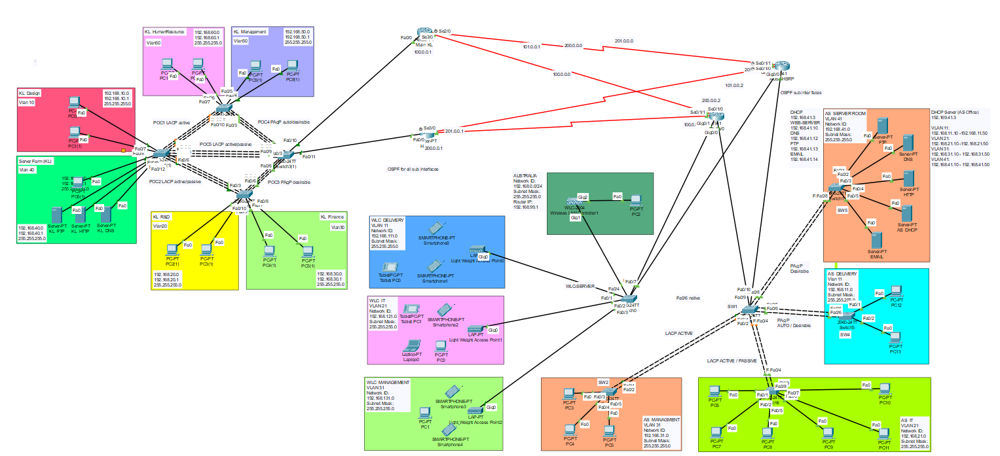

*Overall Cloud Co network topology, as documented in the assignment.*

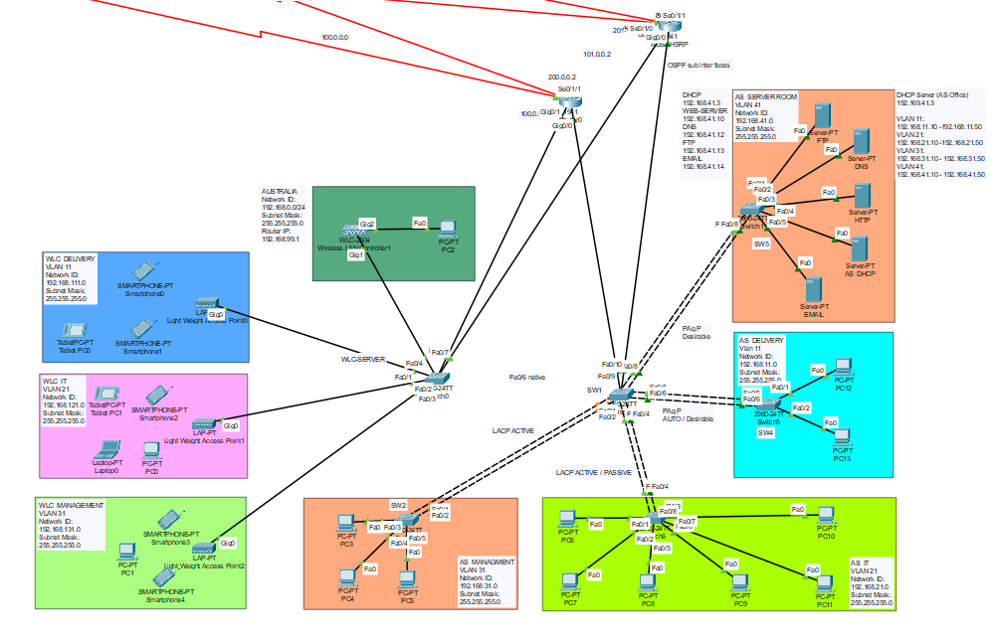

*Australia network with department-level segmentation, services, and wireless access.*

### Network segmentation and IPv4 plan

| Segment | VLAN | Network | Purpose |
|---|---:|---|---|
| Delivery | 11 | `192.168.11.0/24` | Delivery team devices |
| IT | 21 | `192.168.21.0/24` | IT workstations |
| Management | 31 | `192.168.31.0/24` | Management devices |
| Server room | 41 | `192.168.41.0/24` | Shared infrastructure services |
| Wireless controller | — | `192.168.141.0/24` | WLC management network documented in addressing table |

I used department-specific VLANs to separate traffic logically and support a more manageable enterprise design. Client machines are shown using **DHCP** rather than manually assigned addresses.

## What I implemented

### 1. Departmental LAN design

I built separate access-switch segments for **Delivery, IT, and Management**, connected through the core switching infrastructure. I assigned access ports to their departmental VLANs and documented endpoint addressing and connectivity.

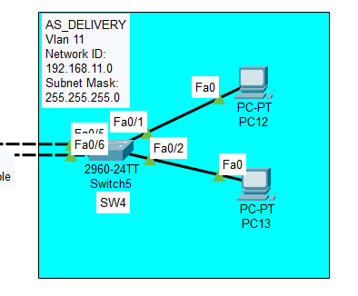

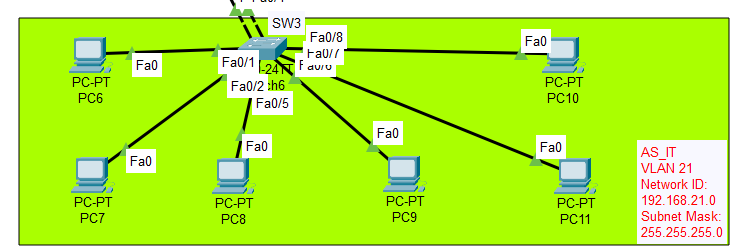

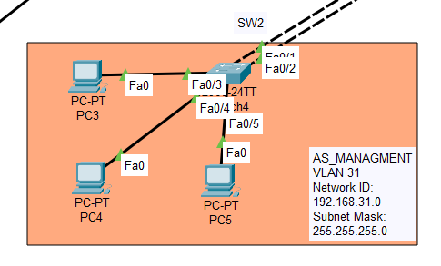

### 2. Centralized network services

I configured a dedicated server-room segment to host the services required by the enterprise simulation:

- **DHCP:** automated client address allocation for department networks.
- **DNS:** internal name resolution.
- **HTTP/HTTPS:** web-service hosting in the simulation.
- **FTP:** file-transfer service.
- **Email:** mail service configuration.

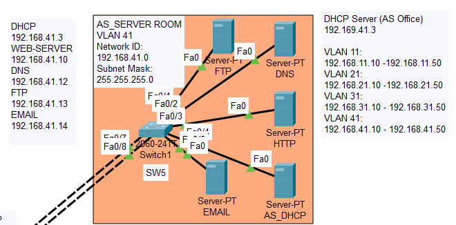

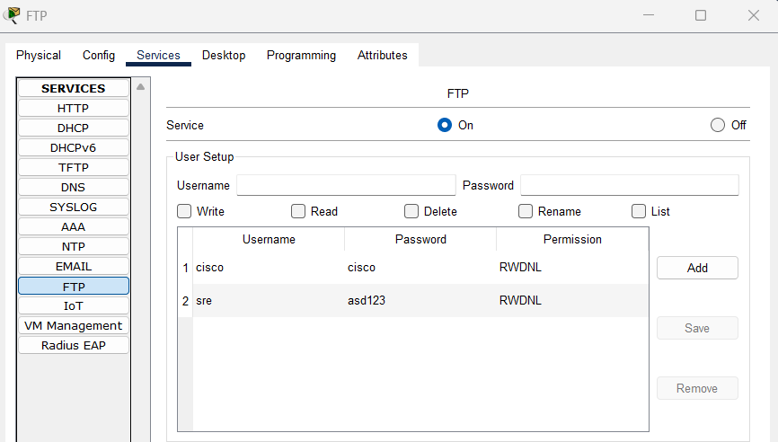

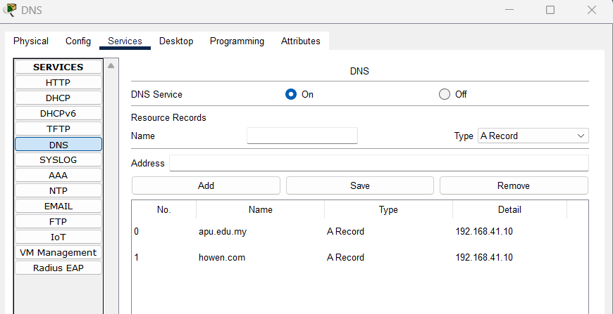

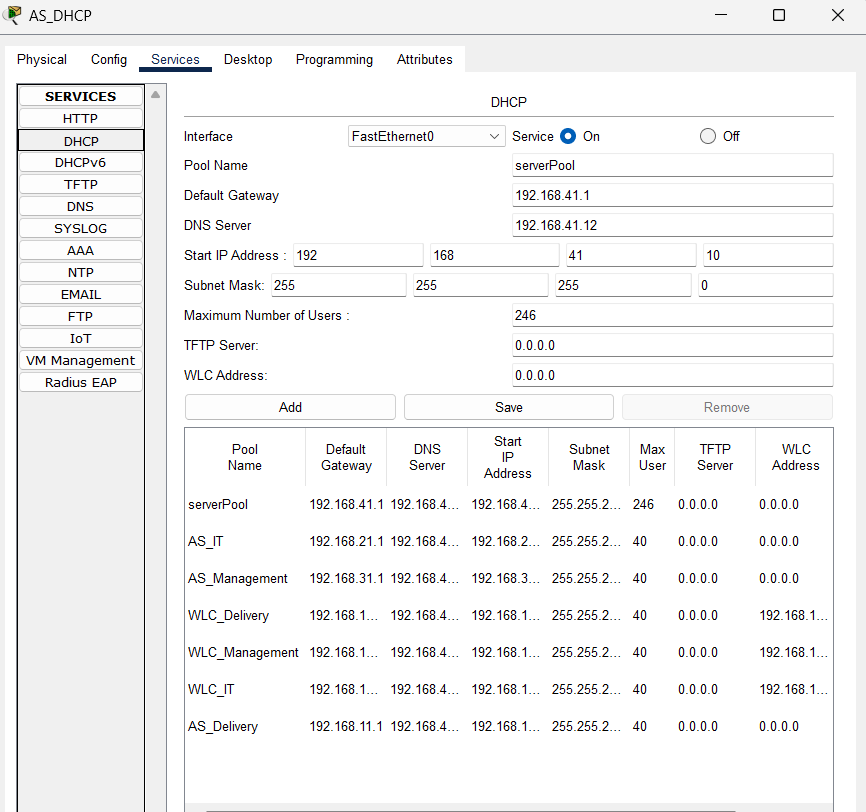

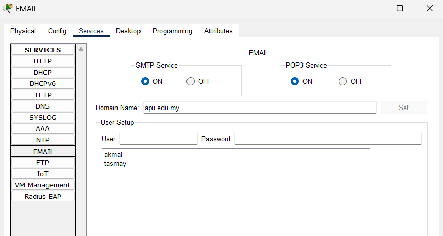

### 3. Wireless LAN Controller and WLAN security

I integrated a **Cisco WLC-2504** and lightweight access points to centralize wireless network administration. I documented department-specific WLAN profiles for Delivery, IT, and Management, using **WPA2-PSK/AES** in the Packet Tracer simulation.

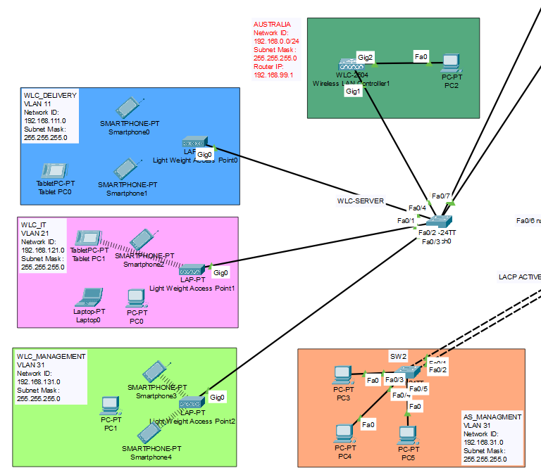

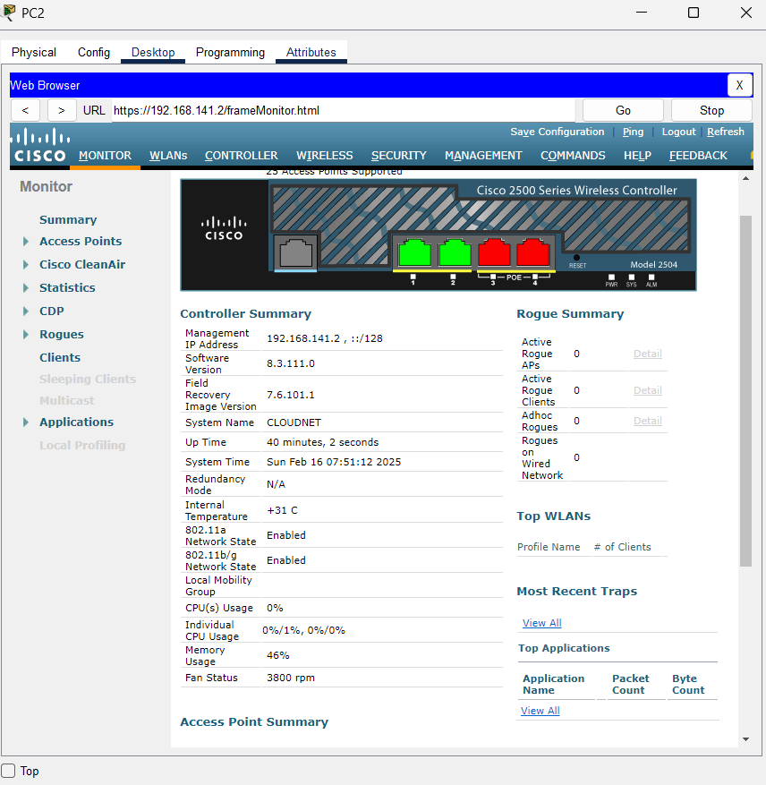

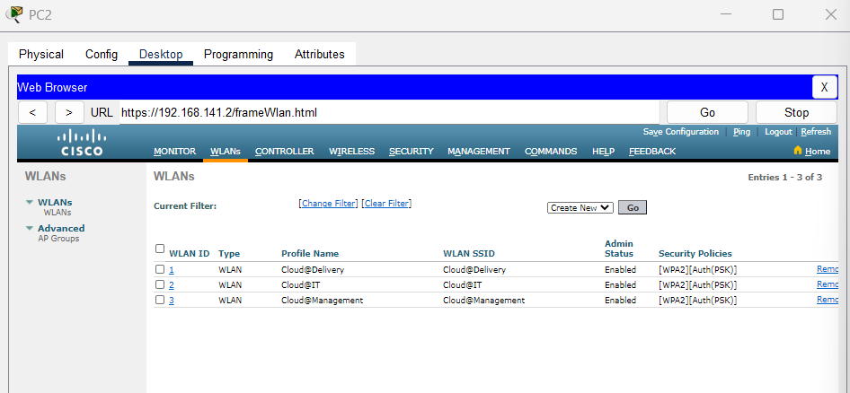

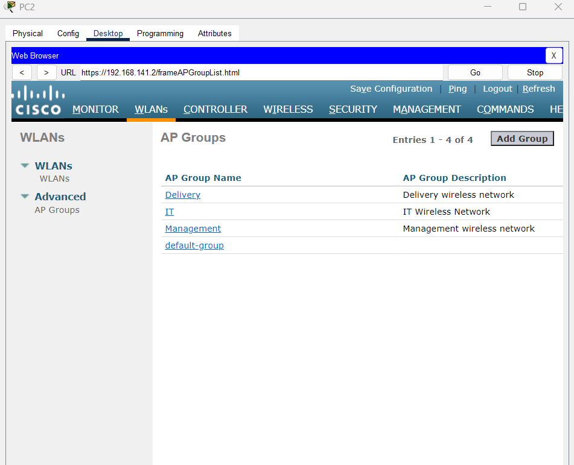

The wireless screenshots demonstrate configuration of multiple wireless endpoint types, including smartphones, tablets, laptops, and PCs.

### 4. EtherChannel for link aggregation

I documented **four EtherChannel port channels** connecting the Australia core switch to the department/server-room switches. The configuration uses **LACP and PAgP** across the port channels, with bundled links shown as active in the CLI output.

| Port channel | Destination | Protocol shown in CLI |
|---|---|---|
| Po1 | Management | LACP |
| Po2 | IT | LACP |
| Po3 | Delivery | PAgP |
| Po4 | Server room | PAgP |

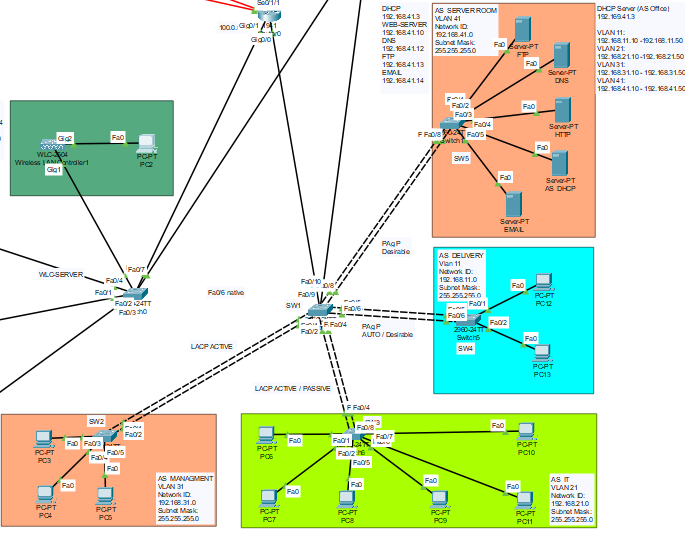

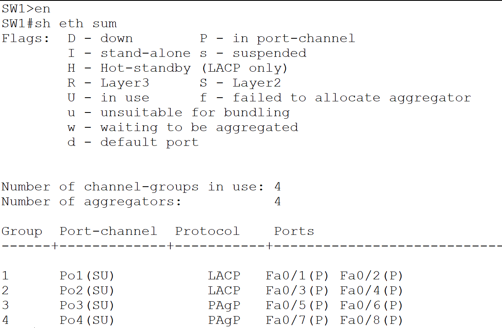

The CLI evidence shows **four channel groups** and bundled member ports, illustrating how aggregated connections can improve resilience and available link capacity.

## Technical skills demonstrated

`Cisco Packet Tracer` · `Enterprise Network Design` · `IPv4 Subnetting` · `VLAN Segmentation` · `Switching` · `DHCP` · `DNS` · `HTTP/HTTPS` · `FTP` · `Email Services` · `Wireless LAN Controller` · `WPA2-PSK` · `LACP` · `PAgP` · `Network Documentation`

## Evidence and documentation

The repository includes **the original assignment documentation** and extracted screenshots/diagrams. The original document is the primary source for the topology and configuration descriptions.

- **Network layout:** original report, pages 1–2.
- **Addressing and VLAN design:** pages 3–15.
- **Server configurations:** pages 16–19.
- **WLC and wireless security:** pages 20–37.
- **EtherChannel:** pages 38–39.

**Documentation scope:** The report contains headings for Kuala Lumpur-specific configurations and HSRP, but does not provide comparable implementation detail for those sections. Accordingly, I do **not** claim verified HSRP failover testing or complete Kuala Lumpur configuration evidence. The `.pkt` Packet Tracer project file is not included in the uploaded source, so this repository documents the work rather than providing a directly runnable simulation.

## Security considerations and improvements

The assignment uses illustrative wireless passphrases and simulated service credentials. These should **not** be reused in a real network. For a production-oriented implementation, I would strengthen WLAN authentication (for example, enterprise-managed authentication where appropriate), apply access control lists between sensitive VLANs, harden server access, and validate failover and network monitoring.

## Author

**Fairouz Abdulrahman Hamed Mousa**  
BSc Computer Science (Cyber Security) · Asia Pacific University, Malaysia

*Academic networking project presented as an individual technical portfolio entry.*
